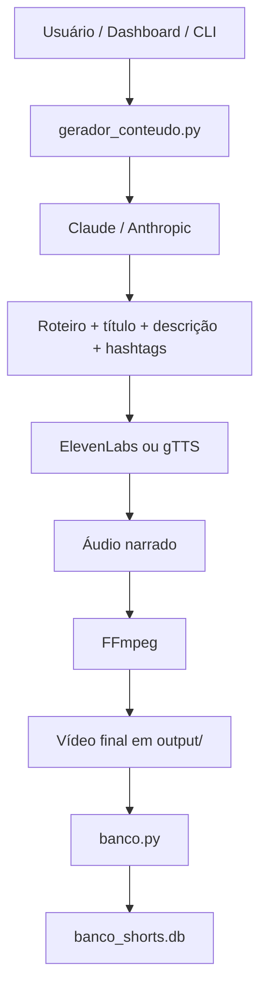
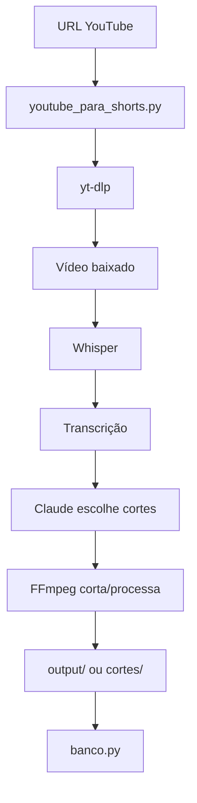
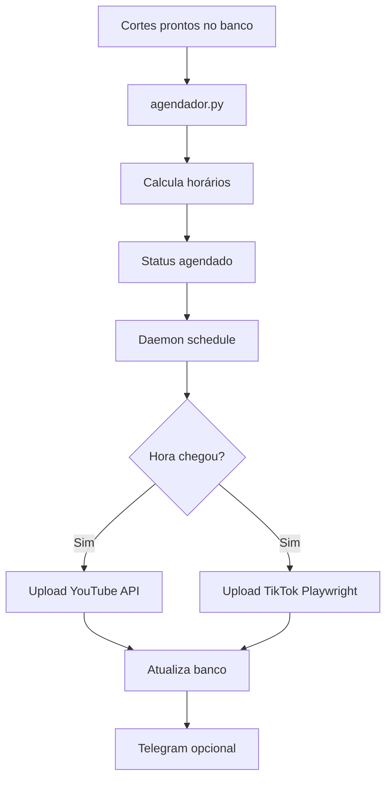
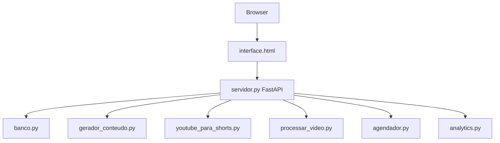

# Arquitetura Atual — BOOMVIBES

> Documento criado na ETAPA 1 do plano de evolução profissional do projeto.  
> Escopo desta etapa: **análise da arquitetura atual, pontos de entrada, componentes, riscos e próximos passos**.  
> Nenhuma lógica funcional foi alterada nesta etapa.

## 1. Visão geral

O BOOMVIBES é um sistema local de automação para criação, processamento, agendamento, publicação e análise de vídeos curtos para YouTube Shorts e TikTok.

A arquitetura atual é majoritariamente composta por scripts Python independentes, coordenados por:

- uma interface web local com FastAPI (`servidor.py`);
- um agendador/daemon para publicação (`agendador.py`);
- pipelines de geração/processamento de vídeo (`gerador_conteudo.py`, `youtube_para_shorts.py`, `processar_video.py`, `viral_enhancer.py`);
- banco SQLite local (`banco_shorts.db`) manipulado por `banco.py`;
- integrações externas com APIs e ferramentas locais.

O sistema está funcional, mas ainda tem características de projeto script-first: muitas responsabilidades em arquivos grandes, dependência de estado local, credenciais em arquivos locais, processos externos via subprocess e automação browser para TikTok.

## 2. Objetivos funcionais existentes

O projeto cobre os seguintes fluxos principais:

1. Gerar vídeos religiosos com IA.
2. Gerar narração por ElevenLabs ou fallback gratuito.
3. Baixar vídeos de YouTube e gerar cortes para Shorts.
4. Processar vídeos locais para formato vertical 9:16.
5. Adicionar legenda, fundo, logo, efeitos, pitch e metadados.
6. Registrar vídeos/cortes no banco SQLite.
7. Agendar publicações.
8. Publicar no YouTube via OAuth/API oficial.
9. Publicar no TikTok via Playwright/browser automation.
10. Expor dashboard local via FastAPI.
11. Coletar métricas do YouTube Analytics.
12. Enviar notificações via Telegram.
13. Baixar fundos/músicas de Pexels/Pixabay.
14. Executar pipeline diário automatizado.

## 3. Estrutura principal do projeto

### Entrada web/API

| Arquivo | Responsabilidade |
| --- | --- |
| `servidor.py` | Servidor FastAPI local principal e dashboard. Expõe endpoints para geração, processamento, agendamento, analytics, config, logs e health. |
| `interface.html` | Interface web local consumida pelo servidor. |
| `api/main.py` | API FastAPI mínima/separada, atualmente com roteador simples. |
| `api/routes.py` | Rota raiz simples da API alternativa. |
| `api/schemas.py` | Arquivo vazio no momento da análise. |

### Pipelines de criação/processamento

| Arquivo | Responsabilidade |
| --- | --- |
| `gerador_conteudo.py` | Gera conteúdo original com IA, voz, legenda e vídeo final. |
| `youtube_para_shorts.py` | Baixa vídeo do YouTube, transcreve, seleciona cortes com IA e gera Shorts. |
| `processar_video.py` | Processa vídeo local, transcreve e gera cortes verticais. |
| `viral_enhancer.py` | Otimizações virais: hook analyzer, legendas dinâmicas, cortes dinâmicos e validações. |
| `fundos.py` | Baixa/gerencia vídeos de fundo e músicas gratuitas. |
| `utils.py` | Funções utilitárias compartilhadas por pipelines. |

### Persistência e agendamento

| Arquivo | Responsabilidade |
| --- | --- |
| `banco.py` | Camada SQLite: inicialização de tabelas, registro de vídeos/cortes, status, métricas e CLI administrativa. |
| `agendador.py` | Agenda cortes, autentica YouTube, faz upload para YouTube/TikTok, roda daemon com `schedule`. |
| `run_diario.py` | Orquestra pipeline diário: geração, processamento de URLs, agendamento e resumo. |
| `limpar_postados.py` | Remove arquivos locais de vídeos já postados. É destrutivo e deve ser tratado com cuidado. |

### Integrações externas

| Arquivo | Responsabilidade |
| --- | --- |
| `telegram.py` | Notificações via Telegram Bot API. |
| `tiktok.py` | Upload no TikTok usando Playwright e sessão salva. |
| `analytics.py` | Coleta métricas via YouTube Analytics API e gera recomendações por IA. |
| `retry.py` | Helpers de retry/backoff para APIs Anthropic, ElevenLabs e YouTube. |

### Configuração, logging e constantes

| Arquivo | Responsabilidade |
| --- | --- |
| `config.py` | Configuração centralizada via `.env`/ambiente e paths padrão. |
| `logger_setup.py` | Logging centralizado com console colorido, `logs/app.log` e `logs/errors.log`. |
| `constantes.py` | Constantes de cores, rate limits, extensões, timeouts, banco e limites de plataformas. |
| `.env.example` | Template de configuração. |
| `.gitignore` | Ignora `.env`, bancos, logs, vídeos, sessões e credenciais — mas alguns arquivos já estão rastreados historicamente. |

### Testes e qualidade

| Arquivo/pasta | Responsabilidade |
| --- | --- |
| `tests/` | Testes unitários e de segurança existentes. |
| `pytest.ini` | Configuração do pytest com `pythonpath = .` e `testpaths = tests`. |
| `.github/workflows/tests.yml` | CI para testes/lint em Ubuntu/Windows e Python 3.10/3.11/3.12. |
| `requirements.txt` | Dependências principais. Observação: arquivo detectado como UTF-16/contendo bytes nulos em leitura anterior. |
| `requirements-dev.txt` / `requirements-test.txt` | Dependências auxiliares. |

## 4. Pontos de entrada identificados

### Execução local principal

```bash
python servidor.py
```

Sobe o dashboard local FastAPI em `127.0.0.1:8000`.

### Agendador/publicação

```bash
python agendador.py --auth
python agendador.py --agendar-lote
python agendador.py --listar
python agendador.py --postar-agora CORTE_ID
python agendador.py --daemon
```

### Geração de conteúdo

```bash
python gerador_conteudo.py
python gerador_conteudo.py --formato reflexao
python gerador_conteudo.py --formato historia
python gerador_conteudo.py --formato versiculo
python gerador_conteudo.py --quantidade 3
python gerador_conteudo.py --longo
```

### YouTube para Shorts

```bash
python youtube_para_shorts.py --url URL
python youtube_para_shorts.py --url URL --forcar
```

### Vídeo local para Shorts/TikTok

```bash
python processar_video.py --arquivo video.mp4
python processar_video.py --pasta pasta_de_videos
```

### TikTok

```bash
python tiktok.py --instalar
python tiktok.py --login
python tiktok.py --testar
python tiktok.py --postar video.mp4
```

### Analytics

```bash
python analytics.py --coletar
python analytics.py --analisar
python analytics.py --relatorio
python analytics.py --top 10
python analytics.py --recomendacoes
```

### Pipeline diário

```bash
python run_diario.py
python run_diario.py --instalar-cron
python run_diario.py --status
python run_diario.py --remover-cron
```

### Banco

```bash
python banco.py --listar
python banco.py --listar-cortes ID_DO_VIDEO
python banco.py --listar-prontos
python banco.py --stats
python banco.py --resetar URL_OU_ID
python banco.py --temas
python banco.py --importar-output
```

## 5. Fluxos de execução

### 5.1 Fluxo de geração original com IA



### 5.2 Fluxo YouTube para Shorts



### 5.3 Fluxo de publicação agendada



### 5.4 Fluxo dashboard local



## 6. Banco de dados

O projeto usa SQLite local (`banco_shorts.db`) via `banco.py`.

Características observadas:

- Conexões abertas por context manager.
- `PRAGMA journal_mode=WAL` habilitado.
- `PRAGMA foreign_keys=ON` habilitado.
- Tabelas principais incluem vídeos e cortes.
- Status de cortes incluem `pronto`, `agendado`, `postado`, `erro`.
- `analytics.py` adiciona/garante tabelas complementares para métricas e recomendações.

Pontos de atenção:

- SQLite é adequado para uso local, mas exige cuidado com concorrência quando dashboard, daemon e scripts rodam ao mesmo tempo.
- A camada de banco ainda é script-oriented, não há camada de repositório/serviço formal.
- Existem operações destrutivas/administrativas via CLI (`--resetar`, limpeza de postados) que devem ser protegidas por confirmação em fases futuras.

## 7. Dependências externas

### APIs/serviços

| Serviço | Uso |
| --- | --- |
| Anthropic / Claude | Geração de roteiros, seleção de cortes, análise de performance. |
| ElevenLabs | Narração por voz IA. |
| Google YouTube Data API v3 | Upload de vídeos no YouTube. |
| YouTube Analytics API | Coleta de métricas. |
| Telegram Bot API | Notificações. |
| TikTok Web | Publicação via automação Playwright. |
| Pexels API | Vídeos de fundo. |
| Pixabay API | Músicas/fundos. |

### Ferramentas locais

| Ferramenta | Uso |
| --- | --- |
| FFmpeg / ffprobe | Corte, renderização, conversão e inspeção de vídeo/áudio. |
| yt-dlp | Download de vídeos do YouTube. |
| Whisper | Transcrição local. |
| Playwright/Chromium | Automação do TikTok. |
| schedule | Loop de agendamento do daemon. |
| FastAPI/Uvicorn | Dashboard/API local. |
| SQLite | Persistência local. |

## 8. Endpoints FastAPI principais

`servidor.py` expõe endpoints para:

- `/` — interface local.
- `/api/logs/stream` — stream SSE de logs.
- `/api/stats` — estatísticas gerais.
- `/api/cortes` — listagem de cortes.
- `/api/videos` — listagem de vídeos.
- `/api/fila/proximas` — próximas postagens.
- `/api/gerar` — geração de conteúdo.
- `/api/pipeline/rodar` e `/api/pipeline/status` — execução/status de pipeline.
- `/api/youtube/processar` — processar URL do YouTube.
- `/api/local/processar` — processar upload local.
- `/api/agendar/lote` e `/api/agendar/corte/{corte_id}` — agendamento.
- `/api/postar/agora/{corte_id}` — postagem imediata.
- `/api/daemon/iniciar`, `/api/daemon/parar`, `/api/daemon/status` — controle do daemon.
- `/api/analytics/coletar`, `/api/analytics/analisar`, `/api/analytics/dados` — analytics.
- `/api/config`, `/api/config/testar` — configuração.
- `/api/urls-diarias` — URLs diárias.
- `/api/output/listar`, `/api/output/download/{nome}` — arquivos gerados.
- `/api/health` — health check básico.

## 9. Estado de testes observado

### Resultado da suíte completa

Execução anterior da suíte completa registrou:

```text
73 failed, 71 passed, 2 warnings in 224.22s
```

Falhas predominantes observadas:

- `tests/test_utils.py`: múltiplos `ImportError`, indicando divergência entre testes esperados e funções realmente exportadas por `utils.py`.
- `tests/test_servidor.py`: falhas em tratamento de erro, path traversal e concorrência.
- Mensagens de logging com caracteres Unicode podem falhar em ambientes Windows/cp1252.

### Resultado específico do viral_enhancer

A suíte `tests/test_viral_enhancer.py` foi validada anteriormente com sucesso:

```text
28 passed
```

Inclui testes unitários, integração com FFmpeg mockado e casos de segurança contra path/command injection.

### Interpretação

O projeto tem cobertura relevante, mas a suíte completa ainda não é confiável como gate de CI porque parte dos testes parece desatualizada em relação ao código atual. Antes de mudanças funcionais grandes, é recomendável estabilizar testes existentes sem alterar comportamento do produto.

## 10. Riscos de segurança identificados

> Nenhum segredo completo foi exibido neste relatório.

### 10.1 Arquivos sensíveis locais

Verificação local encontrou:

| Arquivo | Existe localmente | Rastreado pelo Git | Risco |
| --- | --- | --- | --- |
| `credentials.json` | Sim | Não no HEAD atual | Credenciais OAuth Google locais. Se publicado, permite abuso/configuração indevida do app OAuth. |
| `token.json` | Sim | Não no HEAD atual | Token OAuth local. Se exposto, pode permitir acesso à conta/autorização associada. |
| `tiktok_session/session.json` | Sim | **Sim** | Sessão/cookies do TikTok rastreados no repositório. Alto risco de sequestro de sessão. |
| `.env` | Sim | Não no HEAD atual | Pode conter chaves de API. Deve permanecer fora do Git. |
| `banco_shorts.db` | Sim | Não no HEAD atual | Pode conter histórico operacional, IDs, caminhos e metadados. |

Observação: `.gitignore` já contém padrões para ignorar esses tipos de arquivo, mas `tiktok_session/session.json` já está rastreado. Arquivos já rastreados continuam versionados mesmo que passem a estar no `.gitignore`.

### 10.2 Recomendações de segurança para etapa futura

Sem rotação automática nesta etapa. Recomenda-se para a etapa de segurança:

1. Remover `tiktok_session/session.json` do rastreamento com `git rm --cached`, sem apagar o arquivo local.
2. Confirmar se o arquivo já foi enviado a remoto; se sim, considerar a sessão comprometida e refazer login/rotacionar sessão.
3. Validar se `credentials.json` e `token.json` aparecem no histórico antigo do Git.
4. Garantir `.env`, tokens, banco local, logs e sessões sempre fora do repositório.
5. Adicionar checagem de secrets no CI antes de pushes futuros.
6. Documentar procedimento seguro de criação de `.env`, OAuth e sessão TikTok.

### 10.3 Automação TikTok

`tiktok.py` depende de Playwright e sessão persistida. Riscos:

- Sessão local é material sensível.
- Mudanças na UI do TikTok podem quebrar upload.
- Automação browser tende a ser frágil e deve ter logs, retries e fallback bem definidos.

### 10.4 Subprocess/FFmpeg

Os pipelines usam `subprocess.run` para FFmpeg, ffprobe, yt-dlp e crontab. Em geral, os comandos observados usam lista de argumentos, o que reduz risco de command injection. Ainda assim, entradas de usuário como paths/URLs devem continuar validadas e normalizadas.

### 10.5 Endpoints locais

O servidor é local, mas expõe ações sensíveis: processar arquivos, iniciar daemon, postar agora, alterar config e baixar outputs. Mesmo em `127.0.0.1`, fases futuras devem considerar:

- autenticação local simples ou token;
- proteção contra CSRF local;
- limites de tamanho de upload;
- validação de path traversal;
- confirmação para ações destrutivas.

## 11. Riscos operacionais e de resiliência

### 11.1 Daemon/agendador

`agendador.py` roda loop com `schedule`. Pontos de atenção:

- Falhas em API externa podem afetar o loop se não forem isoladas em cada job.
- Estado do daemon controlado via dashboard pode conflitar com execução manual.
- Postagem simultânea YouTube/TikTok pode deixar status parcial se uma plataforma falhar.
- Reprocessamento/reagendamento precisa de idempotência clara.

### 11.2 Concorrência

Possíveis concorrências:

- `servidor.py` acessando banco enquanto `agendador.py` atualiza status.
- `run_diario.py` gerando/agendando enquanto dashboard lista/processa.
- múltiplos jobs FFmpeg gravando em `output/`, `cortes/` ou temporários.
- Playwright/TikTok usando sessão única em execuções simultâneas.

SQLite com WAL ajuda, mas não elimina necessidade de locks e transações curtas.

### 11.3 Observabilidade

Já existe logging centralizado e stream de logs no dashboard. Ainda faltam, para padrão mais profissional:

- request IDs/correlation IDs;
- logs estruturados opcionais;
- métricas de jobs;
- health checks mais profundos;
- status separado por dependência externa;
- alertas para falhas repetidas.

### 11.4 Portabilidade

O projeto roda em Windows, mas também contém suporte a cron em `run_diario.py`, que é mais natural em Linux/macOS. Para produção/container, será necessário separar comportamentos por ambiente.

## 12. Problemas técnicos encontrados

1. `tiktok_session/session.json` está rastreado pelo Git, apesar do `.gitignore` conter `tiktok_session/` e `*.json`.
2. Existem arquivos sensíveis locais (`credentials.json`, `token.json`, `.env`) que estão corretamente não rastreados no HEAD atual, mas devem ser auditados no histórico.
3. Suíte completa de testes falha: 73 falhas / 71 passes.
4. `tests/test_utils.py` parece esperar funções que não existem ou foram renomeadas em `utils.py`.
5. `tests/test_servidor.py` indica gaps em erros, path traversal e concorrência.
6. `requirements.txt` foi observado com encoding incompatível/UTF-16, o que pode quebrar ferramentas padrão de Python/CI.
7. `api/` parece uma API mínima paralela ao `servidor.py`, ainda sem integração real com o dashboard principal.
8. Arquivos principais são grandes e acumulam múltiplas responsabilidades.
9. Há operações destrutivas sem camada formal de confirmação em todos os pontos (`limpar_postados.py`, reset de banco, remoção de arquivos locais).
10. Configuração mistura ambiente, defaults fixos e arquivos locais esperados (`credentials.json`, `token.json`).
11. Uso de sessão Playwright do TikTok exige proteção mais rigorosa.
12. CI existe, mas vários steps estão com `continue-on-error: true`, o que reduz sua força como gate de qualidade.

## 13. O que deve ser preservado

Conforme regra do projeto, as próximas etapas devem preservar:

- comportamento atual de geração de conteúdo;
- pipeline de YouTube para Shorts;
- pipeline de vídeo local;
- upload YouTube via OAuth/API;
- upload TikTok via Playwright;
- dashboard local;
- banco SQLite local;
- estrutura de pastas usada por scripts;
- compatibilidade Windows;
- arquivos de mídia locais;
- credenciais/sessões locais sem exibição ou rotação automática.

## 14. Recomendações priorizadas para próximas etapas

### Alta prioridade

1. Resolver exposição de `tiktok_session/session.json` no Git sem apagar a sessão local.
2. Auditar histórico Git para secrets já versionados.
3. Corrigir `.gitignore`/tracking efetivo para secrets, bancos, logs, caches, outputs e mídias.
4. Estabilizar testes existentes antes de refatorações.
5. Corrigir encoding do `requirements.txt` para UTF-8, após avaliar impacto.
6. Melhorar isolamento de exceções no daemon para uma falha externa não derrubar o ciclo.
7. Fortalecer validação de paths e uploads no servidor.

### Média prioridade

1. Separar serviços internos sem reescrever: banco, publicação, pipelines, analytics.
2. Adicionar health check detalhado: banco, FFmpeg, credenciais, Playwright, APIs opcionais.
3. Padronizar logging em todos os scripts via `logger_setup.py`.
4. Adicionar locks para jobs longos e sessão TikTok.
5. Melhorar idempotência de status `pronto` → `agendado` → `postado`/`erro`.
6. Fazer CI falhar de forma gradual: primeiro testes confiáveis, depois lint/type/security.

### Baixa prioridade / evolução posterior

1. Dockerizar execução local.
2. Adicionar compose para dashboard + volumes persistentes.
3. Planejar Kubernetes/Helm apenas depois de estabilizar app local e containers.
4. Adicionar Prometheus/Grafana após métricas internas confiáveis.
5. Documentar runbooks e troubleshooting.

## 15. Estratégia segura de evolução

Para respeitar a regra de não reescrever nem quebrar funcionalidade:

1. Trabalhar por etapas pequenas.
2. Antes de cada alteração de risco, documentar impacto e pedir confirmação.
3. Priorizar mudanças reversíveis.
4. Separar mudanças de segurança, testes, logging e refatoração em commits distintos.
5. Não alterar fluxo TikTok/YouTube sem testes ou validação manual clara.
6. Manter scripts CLI existentes funcionando.
7. Usar testes como rede de segurança, mas primeiro corrigir testes quebrados/desatualizados.
8. Nunca exibir secrets completos em logs, relatórios ou commits.

## 16. Conclusão da ETAPA 1

A arquitetura atual é funcional e cobre um pipeline completo de automação de vídeos curtos, mas ainda precisa de endurecimento profissional em segurança, testes, resiliência e observabilidade.

O maior risco imediato é o rastreamento de `tiktok_session/session.json`. O segundo maior risco é a suíte de testes completa quebrada, pois isso reduz confiança para mudanças futuras.

Próxima etapa recomendada: **ETAPA 2 — Segurança inicial**, começando por proteção de secrets e remoção segura de arquivos sensíveis do rastreamento Git, sem apagar arquivos locais e sem rotacionar credenciais automaticamente.
